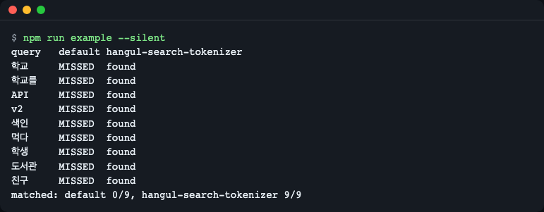
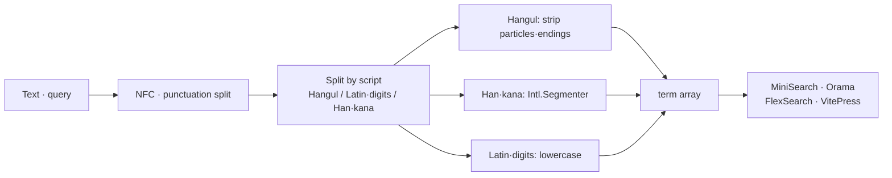
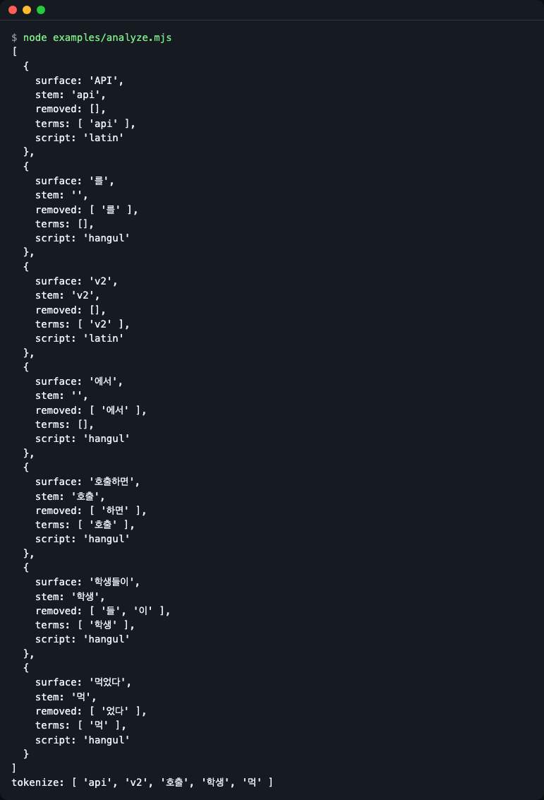
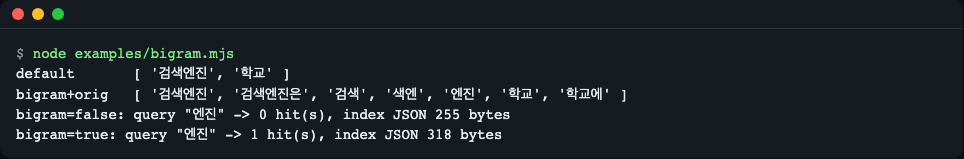
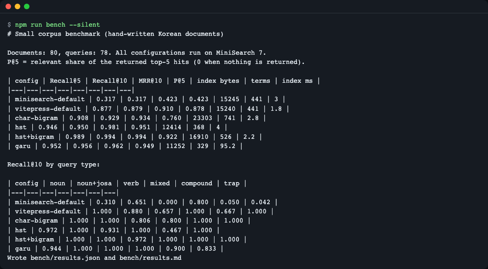

# hangul-search-tokenizer

[한국어](README.md) | **English**

A zero-dependency, synchronous (no `await`) Korean tokenizer for MiniSearch, Orama, FlexSearch and VitePress local search. With one line of configuration it stops searches from missing because of particles and endings: it cuts particles (josa) and verb endings (eomi) at the end of each word, so a query for `학교` (school) also finds `학교에` (at school) and `학교를` (school + object marker), and `먹다` (to eat) finds `먹었다` (ate). Install: `npm install github:LeeGyeongPil/hangul-search-tokenizer` (not published to the npm registry yet). The README includes an honest benchmark that also lists garu, a morphological analyzer that is more accurate in some cases. The benchmark corpus is small and written by the author, so treat the numbers as a direction, not a proof.



*Figure 1. The result of running the same documents and the same queries with MiniSearch's default settings and with this library (`npm run example`).*

## Installation

It has not been published to the npm registry yet. Install it from the GitHub address.

```bash
npm install github:LeeGyeongPil/hangul-search-tokenizer
```

- Installing from GitHub requires `git` (if you don't have it, install it first, for example with `apt-get install -y git`).

- The built `dist/` is included in the repository, so no build step is needed at install time.
- The library can be used on Node 18 or later, modern browsers and edge runtimes. Development and testing require Node 22.12 or later.
- There are 0 runtime dependencies. For MiniSearch, Orama and FlexSearch you just use the one you already use, and this package doesn't require them separately.
- To try it locally, clone the repository and run `npm ci` (see "Development and contributing" below).

## Quick start

Just add one line (`...miniSearchOptions()`) to MiniSearch. The code below is the same as `examples/readme-start.mjs` (I ran it with `node examples/readme-start.mjs` and confirmed `[ 1 ]` and `[ 4 ]`).

```js
import MiniSearch from 'minisearch';
import { miniSearchOptions } from 'hangul-search-tokenizer/minisearch';

const docs = [
  { id: 1, text: '학교에 가서 친구를 만났다' },
  { id: 4, text: '우리는 어제 밥을 먹었다' },
];

const search = new MiniSearch({ fields: ['text'], ...miniSearchOptions() });
search.addAll(docs);

console.log(search.search('학교를').map((hit) => hit.id)); // [ 1 ]
console.log(search.search('먹다').map((hit) => hit.id));   // [ 4 ]
```

(The sample documents read "I went to school and met a friend" and "We ate a meal yesterday".)

Running the full example from the repository prints a table comparing it side by side with the default settings.

```bash
npm run example
```

```text
query	default	hangul-search-tokenizer
학교	MISSED	found
학교를	MISSED	found
API	MISSED	found
v2	MISSED	found
색인	MISSED	found
먹다	MISSED	found
학생	MISSED	found
도서관	MISSED	found
친구	MISSED	found
matched: default 0/9, hangul-search-tokenizer 9/9
```

(The queries are Korean words: school, school + object marker, API, v2, index, to eat, student, library, friend.)

> This example has only 5 documents, so it shows the extreme picture that "the default settings find nothing." On real documents the default settings find some. For the real comparison, see the "Benchmark" section below.

## Why it is needed

Korean is an **agglutinative language** in which particles and endings attach after a word. `학교`, `학교에`, `학교를` and `학교에서` ("school", "at school", "school + object marker", "at/from school") are the same word to a person, but to a search engine that splits only on whitespace they are different chunks of characters. So even if you search for `학교`, you miss documents that contain `학교에`.

By analogy: you are making library index cards, and the book title `학교를` is filed as is in the `ㅎ` slot. Before filing a card, this library cuts the **tail (particle or ending)** off the end of the word with scissors and files it as `학교`, and when a query comes in it cuts with the same scissors.

## Core concepts

### 1. Stripping the tail

From the end of a Hangul word, it strips particles (`을·를·에서·들·이…`) and endings (`었다·하면…`), longest first. If one pass isn't enough, it repeats up to 4 times (`학생들이` → `학생들` → `학생`). It is rule-based with no dictionary, so the file is small and fast. In return, there are cases where it is wrong (see "Limitations" below).

### 2. Indexing and querying must use the same scissors

The **same `tokenize`** must pass over a document when indexing and over a query when processing it, so that they meet. Each engine adapter plugs the same function into both places. If you configure an engine yourself, take care not to change only one side.

### 3. Mixed-script boundaries

It first splits into chunks of Hangul, Latin letters/digits, and Han characters/kana. `API를` is handled as `api` and `를` (a particle, discarded), and `v2에서` as `v2`. Particles attached after quotes, brackets and symbols (`'설정'을`, `(API)를`) are also discarded like `API를`. For chunks of Han characters and kana, it uses `Intl.Segmenter` where possible to keep Chinese and Japanese segmentation.

### 4. Guards against over-stripping

To prevent wrong strips such as `아이` → `아` and `바다` → `바`, it has a built-in exception word list, `noStrip` (user-specified) and `minStemLength` (minimum stem length).



*Figure 2. Processing flow. The input is split by script, only Hangul has its tail stripped, and then everything gathers into a term array and goes into the engine.*

### See what gets cut: `analyze()`

```bash
node examples/analyze.mjs
```



*Figure 3. The analysis result for `API를 v2에서 호출하면 학생들이 먹었다` ("if you call the API (obj.) at v2, the students ate"). `removed` is the tail that was stripped, and `terms` is the value that goes into the index.*

In the text output, the last line is `tokenize: [ 'api', 'v2', '호출', '학생', '먹' ]`. `먹었다` remains as `먹` because processing `먹다` the same way also gives `먹` (`갔다` and `만났다`, which have a `ㅆ` final consonant attached, are restored to `가` and `만나` to match the dictionary form).

## API

All functions work synchronously. Engine packages (MiniSearch, etc.) are not even imported as types (structural typing).

### Main (`hangul-search-tokenizer`)

| Name | What it does | Main arguments | Returns |
|---|---|---|---|
| `createKoreanTokenizer(options?)` | Validates options and creates a tokenizer | `KoreanTokenizerOptions` | `KoreanTokenizer` |
| `resolveOptions(options?)` | Returns the final options with defaults filled in. Invalid values raise `InvalidOptionError` | `KoreanTokenizerOptions` | `Required<KoreanTokenizerOptions>` |
| `tokenize(text)` | Shortcut for a tokenizer with default options | string | `string[]` |
| `KoreanTokenizer.tokenize(text)` | The split shared by indexing and querying | string | `string[]` |
| `KoreanTokenizer.processTerm(term)` | Normalizes one term to NFC and lowercase. An empty string or stopword gives `null`. Whitespace-only input is returned as is without trimming (for passing terms an engine has already split into words) | string | `string \| null` |
| `KoreanTokenizer.analyze(text)` | For debugging, showing what was stripped | string | `AnalyzedToken[]` (`surface`, `stem`, `removed`, `terms`, `script`) |
| `KoreanTokenizer.options` | The final options with defaults filled in (read-only) | - | `Required<KoreanTokenizerOptions>` |
| `builtinRules()` | For inspecting the built-in particle, ending and exception tables | - | `RuleTables` |
| `InvalidOptionError` | The exception thrown when an option type or value is invalid | - | `Error` subclass |

Passing a wrong text type (not a string) raises a `TypeError`.

### Subpath adapters

| Import | Function | Returns |
|---|---|---|
| `hangul-search-tokenizer/minisearch` | `miniSearchOptions(opts?)` | `{ tokenize, processTerm, searchOptions: { tokenize, processTerm } }` (spread into the constructor) |
| `hangul-search-tokenizer/orama` | `oramaTokenizer(opts?)` | `{ language: 'korean', normalizationCache, tokenize }` |
| `hangul-search-tokenizer/flexsearch` | `flexSearchEncoderOptions(opts?)` | `{ normalize: false, split: false, dedupe: false, numeric: false, finalize }` |
| `hangul-search-tokenizer/vitepress` | `vitepressSearch(opts?)` | `{ options: { tokenize, processTerm }, searchOptions: { prefix, fuzzy } }` |

### Options (`KoreanTokenizerOptions`)

| Option | Default | Description |
|---|---|---|
| `keepOriginal` | `false` | Also index the word as written, not just the stem (both `학교` and `학교에`) |
| `bigram` | `false` | For Hangul stems of 3 or more characters, also add 2-character pieces (to find `검색엔진` ("search engine") with `엔진` ("engine")) |
| `minStemLength` | `1` | Don't cut a stem shorter than this many characters (an integer, 1 or more) |
| `cjkSegmenter` | `true` | Split chunks of Han characters and kana with `Intl.Segmenter` (when available) |
| `extraJosa` | `[]` | Additional particles to strip |
| `extraEomi` | `[]` | Additional endings to strip |
| `noStrip` | `[]` | Words never to cut (added to the built-in list) |
| `stopwords` | `[]` | Words to drop from indexing and queries after stem processing |

## Usage examples

### One-line setup per engine

**MiniSearch** — it plugs into both indexing and querying.

```js
const search = new MiniSearch({ fields: ['title', 'body'], ...miniSearchOptions() });
```

**Orama** — it replaces `components.tokenizer`. I confirmed it by running `node examples/orama.mjs`.

```js
import { create, insert, search } from '@orama/orama';
import { oramaTokenizer } from 'hangul-search-tokenizer/orama';

const db = create({ schema: { text: 'string' }, components: { tokenizer: oramaTokenizer() } });
```

```text
학교를 -> [ '학교에 가서 친구를 만났다' ]
학생 -> [ '학생들이 도서관에서 공부한다' ]
공부하다 -> [ '학생들이 도서관에서 공부한다' ]
```

(The documents read "I went to school and met a friend" and "The students study at the library"; the queries are "school (obj.)", "student" and "to study".)

**FlexSearch 0.8** — put the options into an `Encoder` together with `tokenize: 'strict'`. The output of `node examples/flexsearch.mjs` is as follows.

```js
const index = new FlexSearch.Index({
  tokenize: 'strict',
  encoder: new FlexSearch.Encoder(flexSearchEncoderOptions()),
});
```

```text
학교를 -> [ 1 ]
학생 -> [ 2 ]
공부하다 -> [ 2 ]
```

**VitePress local search** — put it in `.vitepress/config.mts` (`examples/vitepress/config.mts`). This repository does not have VitePress as a dependency, so I have not run this snippet on a real site. Instead, the function serialization behavior is checked by tests (see "Cautions" below).

```ts
import { defineConfig } from 'vitepress';
import { vitepressSearch } from 'hangul-search-tokenizer/vitepress';

export default defineConfig({
  themeConfig: {
    search: { provider: 'local', options: { miniSearch: vitepressSearch() } },
  },
});
```

### Compound words: `bigram` and the size trade-off

The default settings see `검색엔진` ("search engine") as one chunk, so you can't find it with `엔진` ("engine"). `bigram: true` indexes extra 2-character pieces so it gets found, but the index gets larger.

```bash
node examples/bigram.mjs
```



*Figure 4. A toy example with only 1 document. Look at the direction, "it gets found but the index grows", rather than the numbers themselves.*

### Don't cut words you made yourself

If a 2-character `…도` word such as `수도` ("capital city") gets cut to `수` and documents with `수 없다` ("cannot") get mixed in, put it in `noStrip`.

```js
miniSearchOptions({ noStrip: ['수도'] });
```

## Benchmark

> **Bias warning — please read first.** The corpus (80 documents) and the queries (78) were written by the library's author. Some of the `trap` queries (`아이`·`바다`·`지도`·`사과`·`회의`·`추가`·`결과`) are on this library's built-in exception list, which favors this library. The numbers from a small corpus are for seeing a direction. To generalize, check it yourself with MIRACL below.

```bash
npm run bench
```



*Figure 5. The benchmark run screen.*

All configurations were run on MiniSearch 7.2.0. P@5 is the proportion of correct results among the top 5 returned, and index bytes is the size of the index serialized as JSON. `hst` is this library (default options).

| Configuration | Recall@5 | Recall@10 | MRR@10 | P@5 | Index bytes | Term count |
|---|---|---|---|---|---|---|
| minisearch-default (whitespace split) | 0.317 | 0.317 | 0.423 | 0.423 | 15245 | 441 |
| vitepress-default (prefix match + fuzzy) | 0.877 | 0.879 | 0.910 | 0.878 | 15240 | 441 |
| char-bigram (character 2-gram) | 0.908 | 0.929 | 0.934 | 0.760 | 23303 | 741 |
| hst | 0.946 | 0.950 | 0.981 | 0.951 | 12414 | 368 |
| hst + `bigram` | 0.989 | 0.994 | 0.994 | 0.922 | 16910 | 526 |
| garu 0.7.0 (morphological analysis) | 0.952 | 0.956 | 0.962 | 0.949 | 11252 | 329 |

Recall@10 by query type:

| Configuration | noun | noun+josa | verb | mixed | compound | trap |
|---|---|---|---|---|---|---|
| minisearch-default | 0.310 | 0.651 | 0.000 | 0.800 | 0.050 | 0.042 |
| vitepress-default | 1.000 | 0.880 | 0.657 | 1.000 | 0.667 | 1.000 |
| char-bigram | 1.000 | 1.000 | 0.806 | 0.800 | 1.000 | 1.000 |
| hst | 0.972 | 1.000 | 0.931 | 1.000 | 0.467 | 1.000 |
| hst + `bigram` | 1.000 | 1.000 | 0.972 | 1.000 | 1.000 | 1.000 |
| garu | 0.944 | 1.000 | 1.000 | 1.000 | 0.900 | 0.833 |

### How to read it

- **VitePress's default settings are already quite good.** Thanks to prefix matching, noun queries (noun, mixed) are equal to or better than `hst`. The difference shows up in verb and adjective queries (0.657 → 0.931) and when a particle is attached on the query side (0.880 → 1.000). So it is fairer to take "VitePress default" rather than "whitespace split" as the baseline.
- **Character 2-gram has high recall**, but loses on precision (P@5 0.760) and index size (23303 bytes, about 1.9 times `hst`).
- **`hst` alone is weak at searching inside compound words** (compound 0.467). Turning on `bigram: true` makes it 1.000, but the index grows by about 36% (12414 → 16910 bytes) and P@5 drops from 0.951 to 0.922.
- **garu leads on verbs (1.000) and compound words (0.900), and has the smallest index.** On the other hand, `trap` was 0.833, lower than `hst` (this item was partly built in `hst`'s favor, as the bias warning above says). Also, initialization is asynchronous, and although it varies per run, the indexing step took tens to 100 ms (`hst` takes a few ms).
- Times (ms) vary per run, so they were left out of the table. If needed, see the `index ms` column in the `npm run bench` result (`bench/results.md`).

### Check it yourself on a larger corpus (optional)

A script that downloads the Korean part of MIRACL (Apache-2.0) and runs the same configurations is included. The data is not put in the repository. The original corpus is about 230MB (compressed), but the script selects and stores only the judged documents and about 20000 extra documents (`bench/.data`, about 14MB), and downloading takes a few minutes.

```bash
npm run bench:download
npm run bench:miracl
```

> I confirmed that both commands succeed to the end in a clean environment (213 queries, 22835 documents). The values from one run were `hst` Recall@10 0.697 / P@5 0.229 / index about 13.5MB, garu 0.766 / 0.266 / about 10.6MB, and VitePress default 0.636. That garu leads and `hst` is light and synchronous is the same as the conclusion above. Times differ by environment. Source: https://huggingface.co/datasets/miracl/miracl (checked 2026-11-10).

## Comparison with other libraries

| | hangul-search-tokenizer | garu-minisearch-tokenizer / garu-orama-tokenizer | VitePress default search |
|---|---|---|---|
| Method | Particle and ending removal rules (no dictionary) | Morphological analysis (WASM model) | Whitespace split + prefix match + fuzzy |
| Initialization | Synchronous | Asynchronous (`await createTokenizer()`) | None |
| Size | Runtime JS about 17KB (about 5.5KB gzip), npm bundle about 18KB (including README) | Model and WASM about 1.8MB | None (built in) |
| Supported engines | MiniSearch · Orama · FlexSearch · VitePress | MiniSearch · Orama | VitePress |
| Irregular verbs and compound words | Weak (outside the rules' range, partly covered by `bigram`) | Strong | Weak |
| Words not in a dictionary (`아이`, etc.) | Defended with an exception list and options | Distinguished by the dictionary | Not applicable |
| License | MIT | Part of the dictionary carries CC BY-SA 2.0 KR terms | MIT |

- **If accuracy matters more, use garu.** In the table above too, garu leads on verbs and compound words. This library is an option for "when you want something light and synchronous that you can use with the same settings across several engines."
- Sources: https://github.com/ongjin/garu , https://www.npmjs.com/package/garu-minisearch-tokenizer , https://vitepress.dev/reference/default-theme-search (checked 2026-11-10).

## Limitations

Because it is a dictionary-free set of rules, the following can be wrong (these were actually wrong in the small benchmark).

- **Over-stripping**: the `서` of `인증서` ("certificate") is seen as an ending and cut to `인증` ("authentication"), so documents with `인증 키` ("authentication key") get mixed in. A 2-character `…도` word not on the exception list (`수도` → `수`) is the same. You can prevent it with `noStrip` and `minStemLength`.
- **Irregular and contracted verbs**: `백업` ("backup") can't find `백업해` ("back up"), `바꾸다` ("to change") can't find `바꿀` ("will change"), and `만들다` ("to make") can't find `만들어` ("make", the -eo form). It also doesn't restore the base form, as in `들었다` → `듣다`.
- **Inside compound words**: `엔진` → `검색엔진` needs `bigram: true`.
- **Short endings**: `고·면·서·지·게` are cut only when the remaining stem is 2 or more characters (to prevent `학교` → `학`).

- **Full-width characters**: only NFC is applied and not NFKC, so full-width alphanumerics (`ＡＰＩ`) don't meet `api`. If needed, normalize them yourself before indexing.

- **A one-character word right after a symbol**: a one-character word attached right after a symbol, such as `A/이` or `…이`, is also treated as a particle and discarded.

If your documents have many such cases, compare with garu too.

## Cautions

- **VitePress sends functions to the browser as strings.** VitePress serializes the functions in the config with `fn.toString()` and runs them in the browser, so a function that references outer variables breaks. `vitepressSearch()` creates a self-contained function that uses no outer identifiers. A test checks that evaluating it in a fresh `node:vm` context gives the same result.
- **One-character stems and prefix matching**: so that a 1-character stem such as `먹` doesn't pull in `먹통` and the like by prefix, the VitePress adapter turns off prefix matching for 1-character terms, and turns off fuzzy for Hangul (a syllable edit distance is too coarse).
- **Orama custom tokenizer**: if you use a custom tokenizer, Orama's built-in English stemming and stopwords are not applied. The adapter fills in the `language` and `normalizationCache` fields.
- **If you are upgrading from 0.1.0**: 0.1.0 indexed particles attached after quotes and brackets, such as `'설정'을` and `(API)를`, left as words (symptom: documents that share only the particle are found). Upgrade to 0.1.1 or later and rebuild the index.
- **Decomposed Hangul (NFD)** input is handled by aligning it to NFC internally. However, for cases where the engine changes the text first, it is safer to turn off the engine-side normalization setting (the adapter specifies `normalize: false` for FlexSearch).

## Versions and compatibility

- It follows semantic versioning (SemVer). During 0.x, the API may change in a minor version, and any change is recorded in [CHANGELOG.md](CHANGELOG.md).
- The current version is 0.1.1 (the first version was 0.1.0). Engine versions used in the benchmark: MiniSearch 7.2.0, Orama 3.1.18, FlexSearch 0.8.212, garu-minisearch-tokenizer 0.7.0.

## Development and contributing

```bash
npm ci
npm test              # build, then 50 tests
npm run bench         # small benchmark
npm run example       # quick-start example
npm run check:dist    # check that the committed dist/ matches the source build result
```

`dist/` is committed for installing from a git URL. `npm run bench` rewrites the time columns of the tracked files `bench/results.json` and `results.md`, so don't commit results where only the times changed (`git checkout bench/results.*`). If you edit the source (`src/`), run `npm run build` and commit `dist/` together. Otherwise `check:dist` fails.

## Further reading

- MiniSearch options: https://lucaong.github.io/minisearch/types/MiniSearch.Options.html
- Orama: https://www.npmjs.com/package/@orama/orama
- FlexSearch Encoder: https://github.com/nextapps-de/flexsearch/blob/master/doc/encoder.md
- VitePress search: https://vitepress.dev/reference/default-theme-search
- MIRACL: https://huggingface.co/datasets/miracl/miracl

(Checked 2026-11-10)

## License

MIT.
