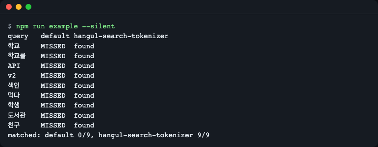
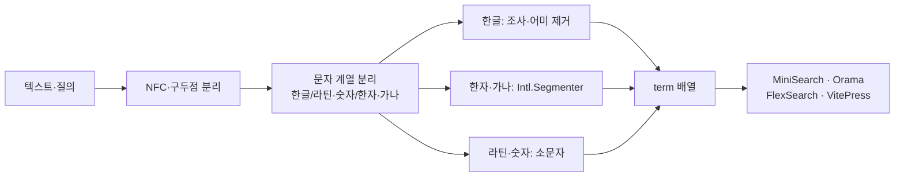
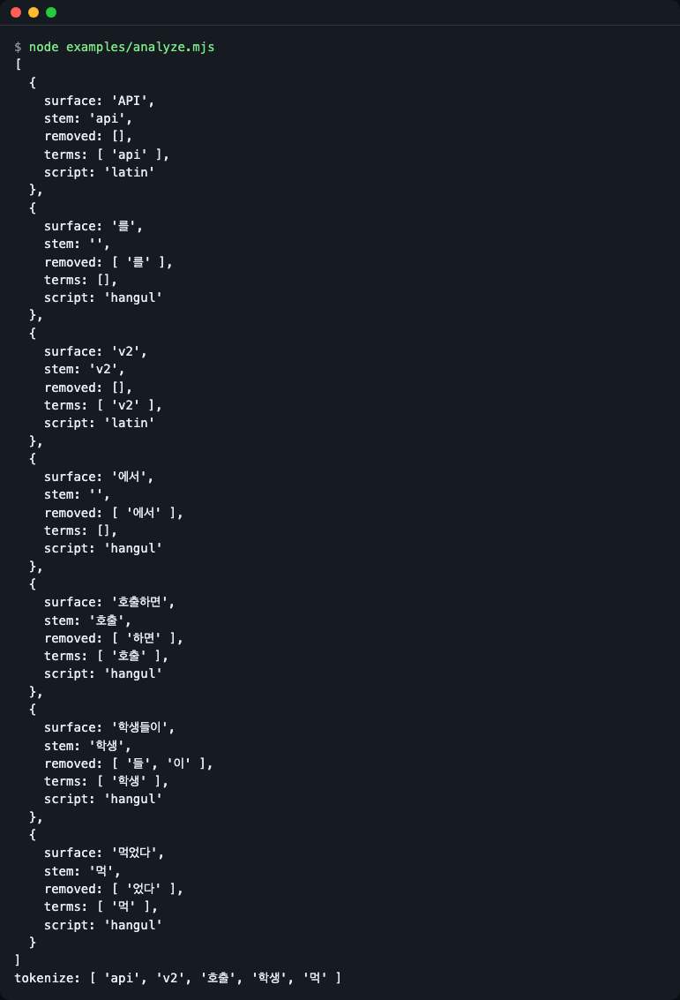
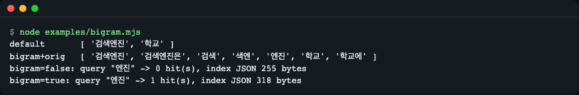
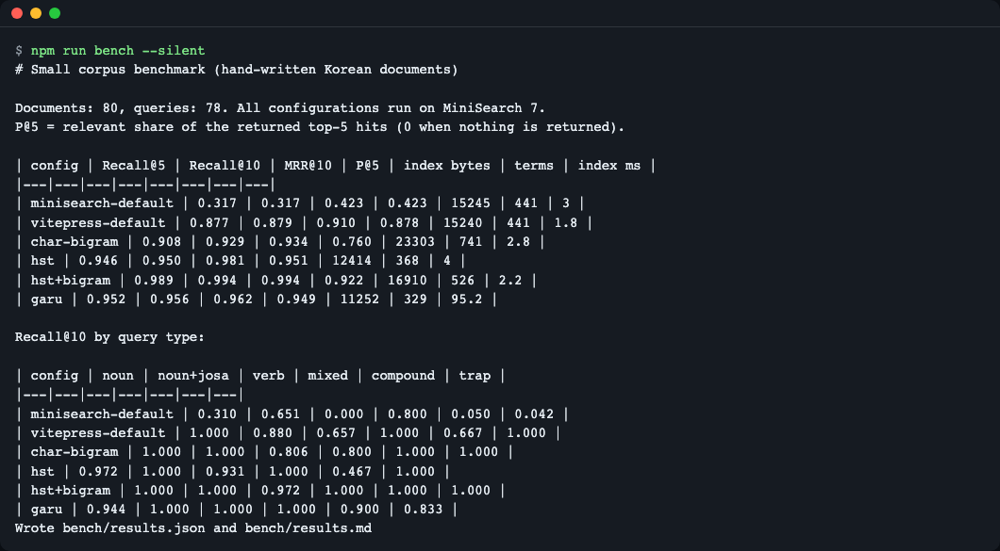

# hangul-search-tokenizer

> **English summary** — A zero-dependency, synchronous Korean tokenizer for MiniSearch, Orama, FlexSearch and VitePress local search. It cuts particles (josa) and verb endings (eomi) at the end of each word, so a query for `학교` also finds `학교에` and `학교를`, and `먹다` finds `먹었다`. Install: `npm install github:LeeGyeongPil/hangul-search-tokenizer` (not published to the npm registry yet). The README includes an honest benchmark that also lists garu, a morphological analyzer that is more accurate in some cases. The benchmark corpus is small and written by the author, so treat the numbers as a direction, not a proof.

한국어 문서를 키워드 검색에 넣을 때, 조사와 어미 때문에 검색이 빗나가는 문제를 설정 한 줄로 줄여 주는 토크나이저입니다. 런타임 의존성이 없고, 동기(`await` 없음)로 동작합니다.



*그림 1. 같은 문서·같은 질의를 MiniSearch 기본 설정과 이 라이브러리로 돌린 결과(`npm run example`).*

## 설치

아직 npm 레지스트리에는 올리지 않았습니다. GitHub 주소로 설치합니다.

```bash
npm install github:LeeGyeongPil/hangul-search-tokenizer
```

- GitHub 설치에는 `git` 이 필요합니다(없으면 `apt-get install -y git` 등으로 먼저 설치).

- 빌드된 `dist/` 가 저장소에 들어 있어서 설치할 때 빌드 단계가 필요 없습니다.
- 라이브러리는 Node 18 이상, 최신 브라우저, 엣지 런타임에서 쓸 수 있습니다. 개발·테스트는 Node 22.12 이상이 필요합니다.
- 런타임 의존성은 0개입니다. MiniSearch·Orama·FlexSearch 는 이미 쓰고 있는 것을 그대로 쓰면 되고, 이 패키지가 따로 요구하지 않습니다.
- 로컬에서 시험하려면 저장소를 clone 하고 `npm ci` 를 실행하면 됩니다(아래 "개발·기여").

## 빠르게 시작하기

MiniSearch 에 한 줄(`...miniSearchOptions()`)만 더하면 됩니다. 아래는 `examples/readme-start.mjs` 와 같은 코드입니다(`node examples/readme-start.mjs` 로 실행해 `[ 1 ]`, `[ 4 ]` 를 확인했습니다).

```js
import MiniSearch from 'minisearch';
import { miniSearchOptions } from 'hangul-search-tokenizer/minisearch';

const docs = [
  { id: 1, text: '학교에 가서 친구를 만났다' },
  { id: 4, text: '우리는 어제 밥을 먹었다' },
];

const search = new MiniSearch({ fields: ['text'], ...miniSearchOptions() });
search.addAll(docs);

console.log(search.search('학교를').map((hit) => hit.id)); // [ 1 ]
console.log(search.search('먹다').map((hit) => hit.id));   // [ 4 ]
```

전체 예제를 저장소에서 실행하면 기본 설정과 나란히 비교한 표가 나옵니다.

```bash
npm run example
```

```text
query	default	hangul-search-tokenizer
학교	MISSED	found
학교를	MISSED	found
API	MISSED	found
v2	MISSED	found
색인	MISSED	found
먹다	MISSED	found
학생	MISSED	found
도서관	MISSED	found
친구	MISSED	found
matched: default 0/9, hangul-search-tokenizer 9/9
```

> 이 예제는 문서 5개짜리라서 "기본 설정이 아무것도 못 찾는다"는 극단적인 모습이 나옵니다. 실제 문서에서는 기본 설정도 일부를 찾습니다. 실제 비교는 아래 "벤치마크" 절을 보세요.

## 왜 필요한가

한국어는 낱말 뒤에 조사와 어미가 붙는 **교착어**입니다. `학교`, `학교에`, `학교를`, `학교에서` 는 사람에게는 같은 낱말이지만, 공백으로만 나누는 검색 엔진에는 서로 다른 글자 덩어리입니다. 그래서 `학교` 를 검색해도 `학교에` 가 들어 있는 문서를 놓칩니다.

비유하면 이렇습니다. 도서관 색인 카드를 만드는데, 책 제목 `학교를` 을 그대로 `ㅎ` 칸에 꽂아 둔 것과 같습니다. 이 라이브러리는 카드를 꽂기 전에 낱말 끝의 **꼬리표(조사·어미)** 를 가위로 잘라 `학교` 로 꽂고, 질의가 들어올 때도 같은 가위로 자릅니다.

## 핵심 개념

### 1. 꼬리표 떼기

한글 낱말 끝에서 조사(`을·를·에서·들·이…`)와 어미(`었다·하면…`)를 가장 긴 것부터 떼어 냅니다. 한 번에 안 끝나면 최대 4번 반복합니다(`학생들이` → `학생들` → `학생`). 사전을 쓰지 않는 규칙 기반이라 파일이 작고 빠릅니다. 그 대신 틀리는 경우도 있습니다(아래 "한계").

### 2. 색인과 질의는 같은 가위를 써야 한다

문서를 색인할 때와 질의를 처리할 때 **같은 `tokenize`** 가 지나가야 서로 만납니다. 각 엔진 어댑터는 두 곳에 같은 함수를 꽂아 줍니다. 직접 엔진을 설정한다면 한쪽만 바꾸지 않도록 주의하세요.

### 3. 혼합 문자 경계

한글, 영문·숫자, 한자·가나 덩어리로 먼저 나눕니다. `API를` 는 `api` 와 `를`(조사, 버림)로, `v2에서` 는 `v2` 로 처리됩니다. 따옴표·괄호·기호 뒤에 붙은 조사(`'설정'을`, `(API)를`)도 `API를` 처럼 버립니다. 한자·가나 덩어리에는 가능하면 `Intl.Segmenter` 를 써서 중국어·일본어 분할을 유지합니다.

### 4. 과제거를 막는 장치

`아이` → `아`, `바다` → `바` 같은 잘못된 제거를 막기 위해 내장 예외 낱말 목록, `noStrip`(직접 지정), `minStemLength`(최소 어간 길이)를 둡니다.



*그림 2. 처리 흐름. 입력은 문자 계열별로 나뉘고, 한글만 꼬리표를 뗀 뒤 term 배열로 모여 엔진으로 들어갑니다.*

### 무엇이 잘리는지 직접 보기: `analyze()`

```bash
node examples/analyze.mjs
```



*그림 3. `API를 v2에서 호출하면 학생들이 먹었다` 의 분석 결과. `removed` 가 떼어 낸 꼬리표, `terms` 가 색인에 들어가는 값입니다.*

텍스트 출력으로는 마지막 줄이 `tokenize: [ 'api', 'v2', '호출', '학생', '먹' ]` 입니다. `먹었다` 가 `먹` 으로 남는 것은 `먹다` 를 같은 방식으로 처리해도 `먹` 이 되기 때문입니다(`ㅆ` 받침이 붙은 `갔다`·`만났다` 는 `가`·`만나` 로 복원해 사전형과 맞춥니다).

## API

모든 함수는 동기로 동작합니다. 엔진 패키지(MiniSearch 등)는 타입으로도 가져오지 않습니다(구조적 타입).

### 메인 (`hangul-search-tokenizer`)

| 이름 | 하는 일 | 주요 인자 | 반환 |
|---|---|---|---|
| `createKoreanTokenizer(options?)` | 옵션을 검증하고 토크나이저를 만듭니다 | `KoreanTokenizerOptions` | `KoreanTokenizer` |
| `resolveOptions(options?)` | 기본값을 채운 최종 옵션을 돌려줍니다. 값이 잘못되면 `InvalidOptionError` | `KoreanTokenizerOptions` | `Required<KoreanTokenizerOptions>` |
| `tokenize(text)` | 기본 옵션 토크나이저 단축형 | 문자열 | `string[]` |
| `KoreanTokenizer.tokenize(text)` | 색인·질의 공통 분할 | 문자열 | `string[]` |
| `KoreanTokenizer.processTerm(term)` | term 하나를 NFC·소문자로 정규화. 빈 문자열·불용어는 `null`. 공백만 있는 입력은 다듬지 않고 그대로 돌려줍니다(엔진이 이미 낱말로 나눈 term 을 넘기는 용도) | 문자열 | `string \| null` |
| `KoreanTokenizer.analyze(text)` | 무엇을 떼었는지 보여 주는 디버그용 | 문자열 | `AnalyzedToken[]` (`surface`, `stem`, `removed`, `terms`, `script`) |
| `KoreanTokenizer.options` | 기본값이 채워진 최종 옵션(읽기 전용) | - | `Required<KoreanTokenizerOptions>` |
| `builtinRules()` | 내장 조사·어미·예외 표 확인용 | - | `RuleTables` |
| `InvalidOptionError` | 옵션 타입·값이 잘못되면 던지는 예외 | - | `Error` 하위 클래스 |

잘못된 텍스트 타입(문자열이 아님)을 넘기면 `TypeError` 가 납니다.

### 하위 경로 어댑터

| 가져오기 | 함수 | 반환 |
|---|---|---|
| `hangul-search-tokenizer/minisearch` | `miniSearchOptions(opts?)` | `{ tokenize, processTerm, searchOptions: { tokenize, processTerm } }` (생성자에 펼쳐 넣기) |
| `hangul-search-tokenizer/orama` | `oramaTokenizer(opts?)` | `{ language: 'korean', normalizationCache, tokenize }` |
| `hangul-search-tokenizer/flexsearch` | `flexSearchEncoderOptions(opts?)` | `{ normalize: false, split: false, dedupe: false, numeric: false, finalize }` |
| `hangul-search-tokenizer/vitepress` | `vitepressSearch(opts?)` | `{ options: { tokenize, processTerm }, searchOptions: { prefix, fuzzy } }` |

### 옵션 (`KoreanTokenizerOptions`)

| 옵션 | 기본값 | 설명 |
|---|---|---|
| `keepOriginal` | `false` | 어간뿐 아니라 쓰인 그대로의 낱말도 색인(`학교`와 `학교에` 둘 다) |
| `bigram` | `false` | 3글자 이상 한글 어간에 2글자 조각도 추가(`엔진`으로 `검색엔진` 찾기) |
| `minStemLength` | `1` | 어간을 이 글자 수보다 짧게 자르지 않음(정수, 1 이상) |
| `cjkSegmenter` | `true` | 한자·가나 덩어리를 `Intl.Segmenter` 로 분할(있을 때) |
| `extraJosa` | `[]` | 추가로 뗄 조사 |
| `extraEomi` | `[]` | 추가로 뗄 어미 |
| `noStrip` | `[]` | 절대 자르지 않을 낱말(내장 목록에 더해짐) |
| `stopwords` | `[]` | 어간 처리 후 색인·질의에서 뺄 낱말 |

## 사용 예

### 엔진별 한 줄 설정

**MiniSearch** — 색인과 질의 양쪽에 꽂힙니다.

```js
const search = new MiniSearch({ fields: ['title', 'body'], ...miniSearchOptions() });
```

**Orama** — `components.tokenizer` 를 교체합니다. `node examples/orama.mjs` 를 실행해 확인했습니다.

```js
import { create, insert, search } from '@orama/orama';
import { oramaTokenizer } from 'hangul-search-tokenizer/orama';

const db = create({ schema: { text: 'string' }, components: { tokenizer: oramaTokenizer() } });
```

```text
학교를 -> [ '학교에 가서 친구를 만났다' ]
학생 -> [ '학생들이 도서관에서 공부한다' ]
공부하다 -> [ '학생들이 도서관에서 공부한다' ]
```

**FlexSearch 0.8** — `tokenize: 'strict'` 와 함께 `Encoder` 에 옵션을 넣습니다. `node examples/flexsearch.mjs` 의 출력은 다음과 같습니다.

```js
const index = new FlexSearch.Index({
  tokenize: 'strict',
  encoder: new FlexSearch.Encoder(flexSearchEncoderOptions()),
});
```

```text
학교를 -> [ 1 ]
학생 -> [ 2 ]
공부하다 -> [ 2 ]
```

**VitePress 로컬 검색** — `.vitepress/config.mts` 에 넣습니다(`examples/vitepress/config.mts`). 이 저장소는 VitePress 를 의존성으로 두지 않아서 이 스니펫은 실제 사이트에서 실행해 보지 않았습니다. 대신 함수 직렬화 동작은 테스트로 확인합니다(아래 "주의").

```ts
import { defineConfig } from 'vitepress';
import { vitepressSearch } from 'hangul-search-tokenizer/vitepress';

export default defineConfig({
  themeConfig: {
    search: { provider: 'local', options: { miniSearch: vitepressSearch() } },
  },
});
```

### 복합어: `bigram` 과 크기의 절충

기본 설정은 `검색엔진` 을 한 덩어리로 보므로 `엔진` 으로는 못 찾습니다. `bigram: true` 는 2글자 조각을 더 색인해서 찾게 하지만 색인이 커집니다.

```bash
node examples/bigram.mjs
```



*그림 4. 문서 1개짜리 장난감 예제입니다. 숫자 자체보다 "찾게 되는 대신 색인이 커진다"는 방향을 보세요.*

### 직접 만든 낱말은 자르지 않기

`수도` 처럼 2글자 `…도` 낱말이 `수` 로 잘려 `수 없다` 문서가 섞이면 `noStrip` 에 올립니다.

```js
miniSearchOptions({ noStrip: ['수도'] });
```

## 벤치마크

> **편향 경고 — 먼저 읽어 주세요.** 말뭉치(문서 80개)와 질의(78개)는 라이브러리 작성자가 직접 썼습니다. `trap` 질의의 일부(`아이`·`바다`·`지도`·`사과`·`회의`·`추가`·`결과`)는 이 라이브러리의 내장 예외 목록에 올라 있어서 이 라이브러리에 유리합니다. 작은 말뭉치의 수치는 방향을 보는 용도입니다. 일반화하려면 아래의 MIRACL 로 직접 확인하세요.

```bash
npm run bench
```



*그림 5. 벤치 실행 화면.*

모든 구성은 MiniSearch 7.2.0 위에서 돌렸습니다. P@5 는 돌려받은 상위 5개 중 정답 비율, 색인 바이트는 색인을 JSON 으로 직렬화한 크기입니다. `hst` 는 이 라이브러리(기본 옵션)입니다.

| 구성 | Recall@5 | Recall@10 | MRR@10 | P@5 | 색인 바이트 | term 수 |
|---|---|---|---|---|---|---|
| minisearch-default (공백 분리) | 0.317 | 0.317 | 0.423 | 0.423 | 15245 | 441 |
| vitepress-default (접두 일치+fuzzy) | 0.877 | 0.879 | 0.910 | 0.878 | 15240 | 441 |
| char-bigram (글자 2-gram) | 0.908 | 0.929 | 0.934 | 0.760 | 23303 | 741 |
| hst | 0.946 | 0.950 | 0.981 | 0.951 | 12414 | 368 |
| hst + `bigram` | 0.989 | 0.994 | 0.994 | 0.922 | 16910 | 526 |
| garu 0.7.0 (형태소 분석) | 0.952 | 0.956 | 0.962 | 0.949 | 11252 | 329 |

질의 유형별 Recall@10:

| 구성 | noun | noun+josa | verb | mixed | compound | trap |
|---|---|---|---|---|---|---|
| minisearch-default | 0.310 | 0.651 | 0.000 | 0.800 | 0.050 | 0.042 |
| vitepress-default | 1.000 | 0.880 | 0.657 | 1.000 | 0.667 | 1.000 |
| char-bigram | 1.000 | 1.000 | 0.806 | 0.800 | 1.000 | 1.000 |
| hst | 0.972 | 1.000 | 0.931 | 1.000 | 0.467 | 1.000 |
| hst + `bigram` | 1.000 | 1.000 | 0.972 | 1.000 | 1.000 | 1.000 |
| garu | 0.944 | 1.000 | 1.000 | 1.000 | 0.900 | 0.833 |

### 어떻게 읽나

- **VitePress 기본 설정은 이미 꽤 잘합니다.** 접두 일치 덕분에 명사 질의(noun·mixed)는 `hst` 와 같거나 낫습니다. 차이는 동사·형용사 질의(0.657 → 0.931)와, 질의 쪽에 조사가 붙은 경우(0.880 → 1.000)에서 납니다. 그래서 비교 기준은 "공백 분리"가 아니라 "VitePress 기본"으로 보는 편이 공정합니다.
- **글자 2-gram 은 재현율은 높지만** 정밀도(P@5 0.760)와 색인 크기(23303 바이트, `hst` 의 약 1.9배)에서 손해를 봅니다.
- **`hst` 단독은 복합어 내부 검색에 약합니다**(compound 0.467). `bigram: true` 를 켜면 1.000 이 되지만 색인이 약 36% 커지고(12414 → 16910 바이트) P@5 가 0.951 → 0.922 로 내려갑니다.
- **garu 는 동사(1.000)와 복합어(0.900)에서 앞서고, 색인이 가장 작습니다.** 반면 `trap` 은 0.833 으로 `hst` 보다 낮았습니다(이 항목은 위 편향 경고대로 `hst` 에 유리하게 짜인 부분이 있습니다). 또 초기화가 비동기이고 실행마다 다르지만 색인 단계에 수십~100ms 정도 걸렸습니다(`hst` 는 수 ms).
- 시간(ms)은 실행마다 달라지므로 표에서 뺐습니다. 필요하면 `npm run bench` 결과(`bench/results.md`)의 `index ms` 열을 보세요.

### 더 큰 말뭉치로 직접 확인하기 (선택)

MIRACL 한국어 부분(Apache-2.0)을 내려받아 같은 구성으로 돌리는 스크립트가 들어 있습니다. 데이터는 저장소에 넣지 않습니다. 원본 코퍼스는 약 230MB(압축 상태)지만 스크립트는 판정 문서와 추가 문서 약 20000개만 골라 저장하며(`bench/.data`, 약 14MB), 내려받는 데 몇 분 걸립니다.

```bash
npm run bench:download
npm run bench:miracl
```

> 깨끗한 환경에서 두 명령이 끝까지 성공하는 것을 확인했습니다(213개 질의, 문서 22835개). 한 번 돌린 값은 `hst` Recall@10 0.697 / P@5 0.229 / 색인 약 13.5MB, garu 0.766 / 0.266 / 약 10.6MB, VitePress 기본 0.636 이었습니다. garu 가 앞서고 `hst` 는 가볍고 동기라는 점이 위 결론과 같습니다. 시간은 환경마다 다릅니다. 출처: https://huggingface.co/datasets/miracl/miracl (2026-11-10 확인).

## 다른 라이브러리와 비교

| | hangul-search-tokenizer | garu-minisearch-tokenizer / garu-orama-tokenizer | VitePress 기본 검색 |
|---|---|---|---|
| 방식 | 조사·어미 제거 규칙(사전 없음) | 형태소 분석(WASM 모델) | 공백 분리 + 접두 일치 + fuzzy |
| 초기화 | 동기 | 비동기(`await createTokenizer()`) | 없음 |
| 크기 | 런타임 JS 약 17KB(gzip 약 5.5KB), npm 묶음 약 18KB(README 포함) | 모델·WASM 약 1.8MB | 없음(내장) |
| 지원 엔진 | MiniSearch·Orama·FlexSearch·VitePress | MiniSearch·Orama | VitePress |
| 불규칙 용언·복합어 | 약함(규칙 범위 밖, `bigram` 으로 일부 보완) | 강함 | 약함 |
| 사전 없는 낱말(`아이` 등) | 예외 목록과 옵션으로 방어 | 사전으로 구분 | 해당 없음 |
| 라이선스 | MIT | 사전 일부에 CC BY-SA 2.0 KR 조건이 있음 | MIT |

- **정확도가 더 중요하면 garu 를 쓰세요.** 위 표에서도 동사·복합어는 garu 가 앞섭니다. 이 라이브러리는 "가볍고 동기이며 여러 엔진에서 같은 설정으로 쓰고 싶을 때"를 위한 선택지입니다.
- 출처: https://github.com/ongjin/garu , https://www.npmjs.com/package/garu-minisearch-tokenizer , https://vitepress.dev/reference/default-theme-search (2026-11-10 확인).

## 한계

사전이 없는 규칙이므로 다음은 틀릴 수 있습니다(소형 벤치에서 실제로 틀린 것들).

- **과제거**: `인증서` 의 `서` 를 어미로 보고 `인증` 으로 잘라 `인증 키` 문서가 섞입니다. 예외 목록에 없는 2글자 `…도` 낱말(`수도` → `수`)도 같습니다. `noStrip`·`minStemLength` 로 막을 수 있습니다.
- **불규칙·축약 용언**: `백업` 이 `백업해` 를, `바꾸다` 가 `바꿀` 을, `만들다` 가 `만들어` 를 못 찾습니다. `들었다` → `듣다` 같은 원형 복원도 하지 않습니다.
- **복합어 내부**: `엔진` → `검색엔진` 은 `bigram: true` 가 필요합니다.
- **짧은 어미**: `고·면·서·지·게` 는 남는 어간이 2글자 이상일 때만 자릅니다(`학교` → `학` 방지).

- **전각 문자**: NFC 만 적용하고 NFKC 는 하지 않아 전각 영숫자(`ＡＰＩ`)는 `api` 와 만나지 않습니다. 필요하면 색인 전에 직접 정규화하세요.

- **기호 바로 뒤의 한 글자 낱말**: `A/이`, `…이` 처럼 기호 바로 뒤에 붙은 한 글자 낱말도 조사로 보고 버립니다.

이런 경우가 많은 문서라면 garu 를 함께 비교해 보세요.

## 주의

- **VitePress 는 함수를 문자열로 브라우저에 보냅니다.** VitePress 가 설정의 함수를 `fn.toString()` 으로 직렬화해서 브라우저에서 실행하기 때문에, 바깥 변수를 참조하는 함수는 깨집니다. `vitepressSearch()` 는 바깥 식별자를 쓰지 않는 자급 함수를 만들어 줍니다. 새 `node:vm` 컨텍스트에서 평가해도 같은 결과가 나오는지 테스트로 확인합니다.
- **한 글자 어간과 접두 일치**: `먹` 같은 1글자 어간이 접두로 `먹통` 등을 끌어오지 않도록 VitePress 어댑터는 1글자 term 에 접두 일치를 끄고, 한글에는 fuzzy 를 끕니다(음절 편집 거리는 너무 거칩니다).
- **Orama 커스텀 토크나이저**: 커스텀 토크나이저를 쓰면 Orama 내장의 영어 stemming·불용어가 적용되지 않습니다. 어댑터는 `language`·`normalizationCache` 필드를 채워 줍니다.
- **0.1.0 에서 올라오는 경우**: 0.1.0 은 `'설정'을`·`(API)를` 처럼 따옴표·괄호 뒤에 붙은 조사를 낱말로 남겨 색인했습니다(증상: 조사만 같은 문서가 검색됨). 0.1.1 이상으로 올리고 색인을 다시 만드세요.
- **분해형 한글(NFD)** 입력은 내부에서 NFC 로 맞춰 처리합니다. 다만 엔진이 먼저 텍스트를 바꾸는 경우를 위해 엔진 쪽 정규화 설정은 끄는 편이 안전합니다(어댑터가 FlexSearch 에는 `normalize: false` 를 지정합니다).

## 버전·호환성

- 유의적 버전(SemVer)을 따릅니다. 0.x 동안은 마이너 버전에서 API 가 바뀔 수 있고, 바뀌면 [CHANGELOG.md](CHANGELOG.md)에 적습니다.
- 현재 버전은 0.1.1 입니다(첫 버전은 0.1.0). 벤치에 쓴 엔진 버전: MiniSearch 7.2.0, Orama 3.1.18, FlexSearch 0.8.212, garu-minisearch-tokenizer 0.7.0.

## 개발·기여

```bash
npm ci
npm test              # 빌드 후 테스트 50개
npm run bench         # 소형 벤치
npm run example       # 빠른 시작 예제
npm run check:dist    # 커밋된 dist/ 가 소스 빌드 결과와 같은지 확인
```

`dist/` 를 git URL 설치용으로 커밋합니다. `npm run bench` 는 추적 파일 `bench/results.json`·`results.md` 의 시간 열을 다시 쓰므로, 시간만 바뀐 결과는 커밋하지 마세요(`git checkout bench/results.*`). 소스(`src/`)를 고치면 `npm run build` 후 `dist/` 도 함께 커밋하세요. 그렇지 않으면 `check:dist` 가 실패합니다.

## 더 알아보기

- MiniSearch 옵션: https://lucaong.github.io/minisearch/types/MiniSearch.Options.html
- Orama: https://www.npmjs.com/package/@orama/orama
- FlexSearch Encoder: https://github.com/nextapps-de/flexsearch/blob/master/doc/encoder.md
- VitePress 검색: https://vitepress.dev/reference/default-theme-search
- MIRACL: https://huggingface.co/datasets/miracl/miracl

(확인일 2026-11-10)

## 라이선스

MIT.
